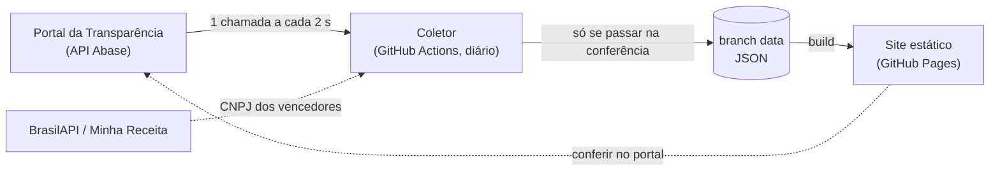

<div align="center">

<picture>
  <source media="(prefers-color-scheme: dark)" srcset="docs/brand/licitacoes-rolante/assets/mark-dark.svg">
  
</picture>

# Licitações Rolante

**O que a Prefeitura de Rolante/RS está licitando, em que situação está cada licitação e quem venceu, com dado real e diário do Portal da Transparência.**

[](https://github.com/filipesfbr/licitacoes-rolante/actions/workflows/ci.yml)


[](LICENSE)

</div>

---

## O que é

Um site que mostra as licitações da Prefeitura de Rolante no ano atual e no anterior: o que está sendo pedido,
o que está aberto, o que foi encerrado, os valores e, quando há, quem venceu. **Todos os dados vêm do
[Portal da Transparência da Prefeitura de Rolante](https://transparencia.abase.com.br/licitacoes/apvqyIT7vjY=)**,
e cada licitação tem link para conferir no próprio portal. O site copia e organiza o que o portal publica: não
estima, não resume e não classifica ninguém como suspeito ou regular.

É da mesma família do [Impostômetro Rolante](https://github.com/filipesfbr/impostometro-rolante) e do
[Gastômetro Rolante](https://github.com/filipesfbr/gastometro-rolante). Site independente, sem vínculo com a
prefeitura. As regras de onde vem cada dado estão em [`docs/fonte-de-verdade.md`](docs/fonte-de-verdade.md) (R1–R9).

> **Estado:** coletor e site prontos localmente, em ajustes. Ainda sem deploy nem domínio.
> Andamento em [`docs/plano.md`](docs/plano.md) (seção 10).

## O que tem

- **Lista das licitações:** cartões com situação, número/ano, modalidade, objeto, prazo ou emissão e valor.
  As que recebem propostas vêm primeiro, pelo prazo mais próximo; as demais, da mais recente para a mais antiga.
- **Filtros e busca:** por ano, por situação e por texto (objeto, modalidade, número/ano e processo), sem
  diferenciar acento.
- **Página de cada licitação:** link próprio para compartilhar, com objeto completo, datas, valor de referência,
  total dos vencedores, itens pedidos e documentos (edital e anexos).
- **Vencedores por empresa:** agrupados por CNPJ, com os itens, a quantidade e o preço como vêm do portal.
  Pessoa física aparece só como «Pessoa física», sem nome nem CPF.
- **Dados da Receita Federal:** data de abertura, situação cadastral e matriz/filial de cada empresa, e o tempo
  entre a abertura e a emissão da licitação. Sempre rotulado como outra fonte e sem selo, cor ou alerta.
- **Histórico de alterações:** toda mudança de situação ou de valor em relação à coleta anterior fica registrada
  e aparece na licitação.
- **De onde vêm os dados:** fonte, data da coleta e link «conferir no portal» em cada licitação.

O **valor dos vencedores** nunca é chamado de «gasto»: registro de preços é teto de compra e leilão é receita.

## Como funciona

Sem servidor e sem banco:



1. Todo dia, às 07:17 de Brasília, o coletor (Node + TypeScript) lê do portal a lista de licitações do ano
   atual e do anterior e, de cada uma, os vencedores, os itens e os documentos. Recolhe tudo de novo, sem
   «só o que mudou», o que também captura alterações retroativas.
2. Para cada licitação, o número de linhas tem de ser igual ao `recordsTotal`, e a soma de quantidade × valor
   dos vencedores tem de bater, em decimal exato, com o `total` do portal (R2). Se algum item falhar, nada é
   publicado e o site continua na coleta anterior. O valor exibido é sempre o `total` do portal: a soma só confere.
3. Nome e CPF de pessoa física são conferidos em memória e **descartados antes de gravar** (R8). A branch `data`
   é pública e o histórico do git é permanente.
4. Os dados dos CNPJs vêm da BrasilAPI, com a Minha Receita de reserva: 1 consulta por segundo, cache de 30 dias
   por CNPJ e no máximo 60 renovações por coleta. API fora do ar não bloqueia a coleta: o site mostra «não consultado».
5. O resultado vai para a branch `data`, que é o registro público dos snapshots (R3).

## Dados

Na branch `data`, gerada pelo coletor (não fica na `main`):

| Arquivo | Conteúdo |
|---|---|
| `licitacoes/AAAA.json` | lista de licitações do ano |
| `detalhes/{codigo}.json` | vencedores, itens e documentos de cada licitação |
| `cnpj.json` | data de abertura, situação e matriz/filial dos CNPJs (Receita Federal) |
| `historico-alteracoes.json` | mudanças de situação e de valor entre coletas (R5) |
| `manifest.json` | data da coleta, validação e SHA-256 de cada arquivo |

| Pasta | O quê |
|---|---|
| `coletor/` | coleta, conferência, normalização e diff |
| `config/` | `fonte.json`: endereço, token e entidade do portal |
| `site/` | o site, em Vite + React |
| `docs/` | regras da fonte de verdade, o plano do projeto e o pacote de marca (`docs/brand/`) |

## Stack

| Camada | Tecnologia |
|---|---|
| Site | React 19, Vite 8, TypeScript strict, Inter local |
| Coletor | Node 24 (roda TypeScript direto), sem build |
| Dados | JSON na branch `data` |
| Deploy | GitHub Pages |
| CI e coleta | GitHub Actions, `ci.yml` e `coleta.yml` |

## Rodar local

Node 24.

```bash
npm ci
npm run coletar    # ~40 min na primeira vez; grava em ./data
npm run dev        # http://localhost:5173, lê ./data
```

Para coletar só um ano: `ANOS=2026 npm run coletar`. Para ler dados de outra pasta: `DATA_DIR=... npm run dev`.

Antes de abrir PR (é o que o CI roda):

```bash
npm run lint && npm run build && npm test
```

## Limites conhecidos

- **O site espelha o portal, inclusive os erros dele.** A conferência prova que a lista e os vencedores
  concordam entre si, não que o portal lançou o valor certo. A licitação 47390 (2015), por exemplo, tem total
  de R$ 95.646.667,59 contra R$ 6.369.405,47 de referência.
- **Só a Prefeitura**, no ano atual e no anterior. A Câmara (`entidade=1`) não tem licitações em 2026.
- **Pessoa física não tem nome.** Em município pequeno, nome parcial com dígitos identifica a pessoa (em
  Chamada Pública, agricultores). O nome continua no portal.
- **Com vários vencedores não há valor por empresa.** O portal só informa o total e o valor por item; o site
  mostra os itens de cada um e nunca um subtotal calculado.
- **Dados da Receita vêm de API de terceiros**, sem garantia de serviço, e são consultados com cache de 30 dias.
- **A prévia ao compartilhar** mostra a imagem geral do site, não a da licitação (rota por hash, `#/licitacao/{codigo}`).
- **Fora da primeira versão:** propostas dos perdedores, alertas por e-mail, ranking de fornecedores e anos
  anteriores ao ano passado.

## Identidade visual

Família Rolante: a gota com um martelo sobre uma moeda (a decisão da licitação e o dinheiro público em jogo),
contorno terracota, fonte Inter, fundo `#faf8f4`, tinta `#26221d` e um único acento, `#b4622f` (âmbar `#d98a52`
no tema escuro). Sem sombras nem gradientes. Os tokens ficam em
[`site/src/styles/tokens.css`](site/src/styles/tokens.css), a marca entra pelos componentes de
[`site/src/components/brand/`](site/src/components/brand/), e os arquivos da marca estão em
[`docs/brand/licitacoes-rolante/`](docs/brand/licitacoes-rolante/assets/).

## Licença e créditos

Licença **MIT**, veja [`LICENSE`](LICENSE). Os dados são públicos e pertencem à fonte: Portal da Transparência
da Prefeitura Municipal de Rolante (Abase Sistemas) e, nos dados de CNPJ, a Receita Federal, via BrasilAPI e
Minha Receita. Projeto independente, sem vínculo com a prefeitura.
